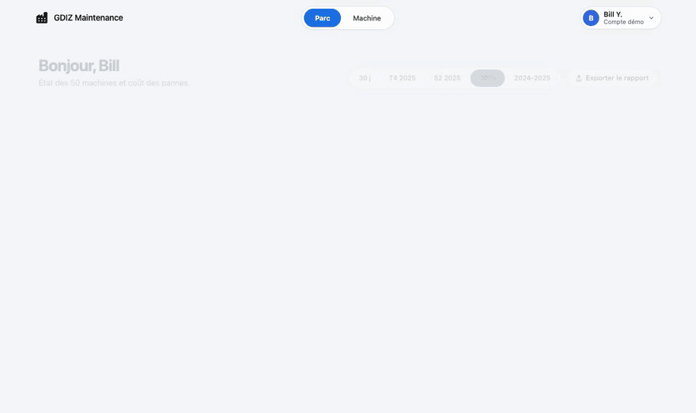

# GDIZ Maintenance prédictive

Anticiper les pannes de machines textiles avant qu'elles n'arrêtent la production. Un atelier textile béninois, sur 2 ans avec des données de capteurs IoT, méteo et réseau SBEE. Chaque machine est évaluée toutes les 30 minutes pour répondre à une question : **va-t-elle tomber en panne dans les 5 prochains jours et pourquoi ?** 





## Essayer en une commande

Prérequis : Python 3.11+ et [uv](https://docs.astral.sh/uv/).

```bash
git clone https://github.com/BillYehouenou/gdiz-predictive-maintenance.git
cd gdiz-predictive-maintenance
make install
make demo
```

Ou, avec Docker seulement (ni Python ni uv) : `docker compose up`, puis http://localhost:8000.


## Déploiement Docker

La stack Compose enchaîne trois services : le registre MLflow (port 5050), un pipeline qui génère les données,
entraîne et score le modèle s'ils manquent, puis l'API avec le tableau de bord (port 8000), qui charge le @champion
et son seuil depuis le registre. Données et registre sont gardés dans des volumes : environ 2 min 30 au premier
lancement, une quinzaine de secondes ensuite.

```bash
make docker-up    # démarre tout et rend la main quand le tableau de bord est prêt
make docker-down  # arrête (docker compose down -v efface aussi les données et le registre)
```

*GitHub Actions* : lint + mypy ; tests avec génération des données et entraînement à la volée ; build Docker. S'exécute sur chaque push et PR vers main.


## Sous le capot

- **Des données crédibles** : météo réelle Open-Meteo, physique d'usure et de surchauffe, capteurs IoT qui
  décrochent ou dérivent ; l'état réel des machines reste caché, seuls les capteurs et la GMAO sont visibles.
- **Une métrique métier soutenable** : part des pannes annoncées dans les 5 jours, sous un budget de fausses
  alertes comptées en interventions, et non en pas de 30 minutes.
- **Un modèle honnête** : LightGBM comparé à quatre autres modèles, dont une simple règle, probabilités calibrées, cause probable regroupée par famille physique.
- **Du MLOps adéquat** : registre MLflow (le modèle n'est promu que si le recall ne baisse pas, avec son seuil),
  DuckDB embarqué, API FastAPI, tableau de bord HTML/CSS/JS sans framework, tests, CI et Docker.


## Choix du modèle

Recall événementiel au budget de 0,2 fausse alerte par machine et par jour
([notebooks/1_comparaison_modeles.ipynb](notebooks/1_comparaison_modeles.ipynb), qui détaille aussi les décisions
de modélisation) :

| Modèle | Validation (T2-T4 2024, 65 pannes) | Test 2025 (115 pannes) | Taille |
|---|---|---|---|
| Règle : heures d'outil | 59 % | 50 % | 0,2 Ko |
| Régression logistique | 58 % | 28 % | 6 Ko |
| Arbre de décision | 53 % | 48 % | 10 Ko |
| HistGradientBoosting | 69 % | 53 % | 338 Ko |
| **LightGBM (déployé)** | **71 %** | **60 %** | 266 Ko |

Incertitude : ±6 points en validation, ±5 au test. Le boosting bat nettement les modèles simples ; entre variantes
de boosting (y compris des LightGBM plus petits), les écarts restent dans le bruit, et la validation et le test ne
s'accordent pas. LightGBM 150 arbres est donc conservé.


## Limites

1. **Données synthétiques, pas des capteurs GDIZ réels** : le générateur reproduit des dynamiques physiques
   plausibles (calendrier saisonnier béninois, réseau SBEE, Harmattan), mais reste une simulation calibrée.
2. **La surcharge mécanique (OSF) reste le point faible**, faute d'exemples ; les pannes électriques et aléatoires
   n'ont pas de signe avant-coureur et ne sont pas apprises.
3. **Préavis médian d'environ 12 h**, pas plusieurs jours : assez pour planifier une intervention le jour même, pas
   pour commander une pièce.
4. **La cause probable est une famille physique (SHAP)** — usure, surchauffe, surcharge, environnement — et non un
   diagnostic du mode de panne : un classifieur multi-classe testé à part était trop instable pour être exposé.

