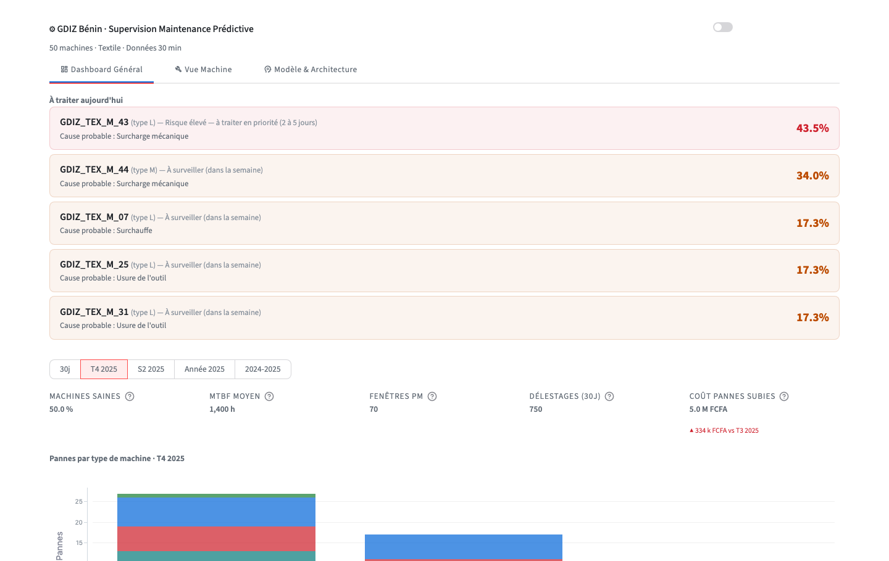
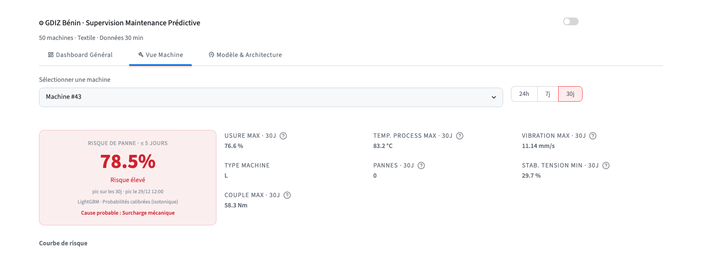

# Maintenance Prédictive Industrielle GDIZ

[](https://github.com/BillYehouenou/gdiz-predictive-maintenance/actions/workflows/ci.yml)


Plateforme MLOps de bout en bout pour la prédiction de pannes en temps réel sur des machines textiles de la Zone Industrielle de Glo-Djigbé, Bénin.


## Résumé

Cette plateforme opérationnalise un modèle LightGBM de prédiction de pannes entraîné sur 1,75 million de relevés IoT (50 machines × 730 jours × 48 pas de 30 minutes). Elle expose une intelligence de maintenance actionnable via un dashboard Streamlit adossé à un moteur analytique DuckDB embarqué, avec MLflow gérant l'intégralité du cycle de vie des expériences. Le système est conçu pour les contraintes opérationnelles spécifiques du parc textile : déséquilibre de classes extrême (~0,02 % de taux de panne brute), instabilité du réseau SBEE et cycles de poussière Harmattan.

La cible n'est pas "panne à cet instant précis" mais "cette machine est-elle dans les 120h qui précèdent une panne d'usure outil (TWF), de surchauffe (HDF) ou de surcharge mécanique (OSF) ?" — les pannes électriques/aléatoires (PWF/RNF) sont exclues du label, vérifié empiriquement sans signal précurseur exploitable. Détail et mesures : `docs/model-decisions.md`.


## Aperçu

| Vue générale — priorités du jour et KPIs du parc | Vue machine — risque, cause probable (SHAP), courbe |
|---|---|
|  |  |


## Résultats

Chiffres mesurés sur le test 2025 (jamais vu à l'entraînement ni pour choisir le seuil) — détail et méthodologie complète : `docs/experiments.md`, `docs/model-decisions.md`.

| Métrique | Valeur |
|---|---|
| Recall événementiel (pannes annoncées à l'avance) | **84,3 %** (97/115) |
| Dont TWF (usure outil) | 100 % |
| Dont HDF (surchauffe) | 78,6 % |
| Dont OSF (surcharge mécanique) | 60,0 % |
| Fausses alertes | 0,215 / machine / jour (~1 tous les 4-5 jours) |
| Préavis médian | 12,5 h |
| Gain vs règle triviale (`usure_outil > seuil`) | +17,8 pts sur HDF, +6,6 pts sur OSF |
| Gain vs régression logistique | Bat la RL sur HDF et OSF ; la RL fait *pire* que la règle triviale sur OSF |

Le modèle bat les deux baselines, mais pas uniformément : sur TWF seul, un simple seuil sur `usure_outil` suffit — la complexité de LightGBM se justifie spécifiquement sur HDF/OSF (relations non linéaires). Voir `docs/model-decisions.md` pour la répartition complète par mode de panne et l'historique des itérations (calibration, ajout de features, étude 50→100 machines).


## Limites assumées

- **Données synthétiques, pas des capteurs GDIZ réels** — le générateur (`scripts/generate_synthetic_data.py`) reproduit des dynamiques physiques plausibles (calendrier saisonnier béninois, réseau SBEE, cycles Harmattan) mais reste une simulation calibrée, pas un historique industriel réel.
- **OSF (surcharge mécanique) reste le point faible** — 60 % de recall, limité par la rareté des exemples (23-30 pannes OSF selon le split) plutôt que par l'architecture ; trois hypothèses d'amélioration testées et invalidées (cf. `docs/model-decisions.md`, "Ré-audit de la variable cible").
- **Préavis médian de 12,5h, pas plusieurs jours** — suffisant pour planifier une intervention le jour même, insuffisant si une pièce doit être commandée à l'avance.
- **PWF/RNF non prédits, par construction** — vérifié empiriquement à deux reprises (mauvais capteurs testés la première fois, bonnes variables causales la seconde) : aucun signal précurseur exploitable, pas une limite de modélisation.
- **Pas d'authentification sur l'API** — hors périmètre assumé dès la conception (cf. `gdiz-roadmap-et-plan.md`, section "Décisions déjà actées").
- **Cause probable = familles physiques (SHAP), pas un diagnostic TWF/HDF/OSF** — l'étage de diagnostic multi-classe testé séparément était trop instable pour être exposé (accuracy validation 46,8 %, OSF quasi jamais reconnu) ; le dashboard affiche plutôt "quel phénomène physique pousse cette alerte" (usure, surchauffe, surcharge mécanique...), une question différente mais toujours fiable.


## Architecture

```
scripts/generate_synthetic_data.py   - Données IoT synthétiques (framework AI4I 2020, adapté GDIZ)
        │
        │
data/raw/gdiz_maintenance.db         - DuckDB : 1,75M lignes, indexé sur (id_machine, timestamp)
        │
src/features.py  (rolling temporel)  src/preprocessor.py  (imputation + catégorielles natives LightGBM)
        │                                     │
        └─────────────────┬───────────────────┘
                          │
        src/train.py : split train/validation/test — seuil choisi sur validation
        (recall événementiel sous budget de fausses alertes, src/evaluation.py) —
        calibration isotonique — MLflow Registry (alias @champion)
                          │     ↳ promotion gatée : la nouvelle version ne remplace le
                          │       @champion que si elle l'égale ou le dépasse sur le
                          │       recall événementiel (jamais un F1/F2 par pas de temps)
                          │
              models/model_pipeline.pkl + models/seuil_optimal.json
                          │
          ┌───────────────┴───────────────┐
          │                               │
  app/main.py (FastAPI)          dashboard.py (Streamlit)
  POST /api/v1/predict           ui/tabs/{general, machine, about}
  POST /api/v1/predict/batch
  GET  /api/v1/info              (version + seuil du champion chargé)
  POST /api/v1/reload            (recharge le @champion sans redémarrer)
```

*Frontière de décision :* `predict_proba()` renvoie des probabilités calibrées (isotonique, ajustée sur la validation — plus de recentrage logit ad hoc). Le seuil de décision est optimisé pour maximiser le recall événementiel sous un budget de fausses alertes (0,2/machine/jour), pas fixé à 50 % — sa valeur réelle change à chaque ré-entraînement (`models/seuil_optimal.json`, ~0,115 au dernier entraînement). Les bandes de risque du dashboard et du monitoring MLflow sont dérivées de ce seuil dynamiquement, pas codées en dur.


## Installation 

Prérequis : Python 3.11+, uv

```bash
# Clone et installe les dépendances
git clone <url-du-repo>
cd gdiz-predictive-maintenance
uv sync --frozen

# Génère le dataset synthétique (une seule fois)
make generate-data

# Entraîne le modèle et l'enregistre dans MLflow
make train

# Dashbord Streamlit
make dashboard

# Optionnel : API d'inférence ou MLFlow UI
make serve ; make mlflow-ui
```


## Déploiement Docker

La stack Compose orchestre trois services dans des conteneurs — avec un séquençage par health-gate et exécution en utilisateur non-root :

```bash
# Placer les artefacts pré-entraînés dans models/ et les données dans data/ avant le build.
docker compose up --build -d # Démarre les services en arrière-plan
docker compose down # Arrête et supprime les conteneurs
```

L'image Docker ne contient ni données d'entraînement ni artefacts de modèle.


## Qualité du code

```bash
make lint         # ruff check + format --check + mypy (src/, app/)
make test         # pytest avec couverture (≈70 % sur src/ + app/, gate CI à 65 %)
make check        # lint + tests — gate CI avant merge
make check-drift  # drift KS + PSI, features en prod vs entraînement, et drift des prédictions elles-mêmes
```

Les tests couvrent : chargement du modèle, contrat de sortie des prédictions, robustesse aux colonnes manquantes, détection de surchauffe, tous les endpoints FastAPI (y compris batch, info, reload), le split temporel à 3 voies, la métrique événementielle (épisodes, délai de réarmement), le preprocessing (encodage catégoriel natif, stabilité des codes entre appels), la validation des bornes physiques à l'ingestion (pandera), la détection de drift (PSI), la vue "à traiter aujourd'hui" et l'explication SHAP par famille physique, et la gate de promotion `@champion`.

*GitHub Actions* : lint + mypy - tests avec génération de données et entraînement à la volée (mis en cache entre les runs) - build Docker S'exécute sur chaque push/PR vers la branche main.


## Structure du projet

```
gdiz-predictive-maintenance/
├── app/                    # Application FastAPI
│   ├── main.py             # Routes : /health, /predict(/batch), /info, /reload
│   ├── schemas.py          # Modèles Pydantic entrée/sortie
│   └── utils.py            # Orchestration des prédictions, log MLflow async, rechargement à chaud
├── config/config.yaml      # Chemins, spec dataset, URIs MLflow
├── dashboard.py            # Point d'entrée Streamlit
├── docs/                   # Documentation vivante : méthodologie et mesures
│   ├── data-generation.md    # Choix du générateur synthétique (climat, physique des pannes)
│   ├── experiments.md        # Méthodologie d'évaluation (métrique événementielle, calibration)
│   └── model-decisions.md    # Features, preprocessing, architecture — avec les mesures qui les justifient
├── scripts/
│   ├── generate_synthetic_data.py
│   ├── run_training.py
│   ├── run_baseline_comparison.py  # Règle triviale + régression logistique, à battre par LightGBM
│   └── check_drift.py      # Drift KS + PSI (features) et drift des prédictions elles-mêmes
├── src/                    # Bibliothèque ML principale
│   ├── configloader.py
│   ├── dataloader.py
│   ├── evaluation.py       # Métrique événementielle : recall @ budget de fausses alertes
│   ├── explain.py          # Cause probable par famille physique (SHAP), point 33 roadmap
│   ├── features.py         # Feature engineering temporel (entraînement + inférence)
│   ├── preprocessor.py     # Imputation + encodage catégoriel natif LightGBM
│   ├── train.py            # Split 3 voies + calibration isotonique + gate de promotion @champion
│   ├── validation.py       # Bornes physiques à l'ingestion (pandera), tolérantes à la dérive capteur
│   └── xpredict.py         # Predicteur — probabilités calibrées, pas de recentrage ad hoc
├── tests/                  # Suite pytest
├── ui/                     # Modules UI Streamlit
│   ├── constants.py        # Palettes, constantes coûts métier, maps de périodes
│   ├── helpers.py          # Helpers mise en page graphiques, utilitaires de formatage
│   ├── priorites.py        # Vue "à traiter aujourd'hui" — machines en alerte triées par risque
│   ├── queries.py          # Couche requêtes DuckDB 
│   ├── styles.py           # Injection du thème global CSS-in-Python
│   └── tabs/
│       ├── tab_general.py  # Onglet vue globale du parc + priorités du jour
│       ├── tab_machine.py  # Onglet analyse par machine + cause probable (SHAP)
│       └── tab_about.py    # Onglet architecture du pipeline
├── Dockerfile
├── docker-compose.yml
├── Makefile
└── pyproject.toml
```
