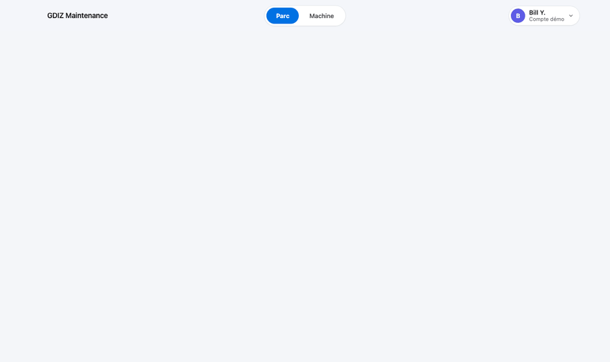

# GDIZ Maintenance prédictive

Anticiper les pannes de machines textiles avant qu'elles n'arrêtent la production. Un atelier textile béninois, sur 2 ans avec des données de capteurs IoT, méteo et réseau SBEE. Chaque machine est évaluée toutes les 30 minutes pour répondre à une question : **va-t-elle tomber en panne dans les 5 prochains jours et pourquoi ?** 





## Essayer en une commande

Prérequis : Python 3.11+ et [uv](https://docs.astral.sh/uv/).

```bash
git clone https://github.com/BillYehouenou/gdiz-predictive-maintenance.git
cd gdiz-predictive-maintenance
make install
make demo
```

Ou, avec Docker seulement (ni Python ni uv) : `docker compose up`, puis http://localhost:8000.


## Déploiement Docker

La stack Compose enchaîne trois services : le registre MLflow (port 5050), un pipeline qui génère les données,
entraîne et score le modèle s'ils manquent, puis l'API avec le tableau de bord (port 8000), qui charge le @champion
et son seuil depuis le registre. Données et registre sont gardés dans des volumes : environ 2 min 30 au premier
lancement, une quinzaine de secondes ensuite.

```bash
make docker-up    # démarre tout et rend la main quand le tableau de bord est prêt
make docker-down  # arrête (docker compose down -v efface aussi les données et le registre)
```

*GitHub Actions* : lint + mypy ; tests avec génération des données et entraînement à la volée ; build Docker. S'exécute sur chaque push et PR vers main.


## Sous le capot

- **Des données crédibles** : météo réelle Open-Meteo, physique d'usure et de surchauffe, capteurs IoT qui
  décrochent ou dérivent ; l'état réel des machines reste caché, seuls les capteurs et la GMAO sont visibles.
- **Une métrique métier soutenable** : part des pannes annoncées dans les 5 jours (et avec au moins 4 h de préavis),
  sous un budget de fausses alertes comptées en interventions, avec la précision des alertes et le bilan en FCFA.
- **Un modèle honnête** : LightGBM comparé à trois autres modèles (régression logistique, arbre, HistGradientBoosting), appris sur les seules
  machines en marche, probabilités calibrées, cause probable regroupée par famille physique.
- **Du MLOps adéquat** : registre MLflow (le modèle n'est promu que si son gain net en validation ne baisse pas, avec
  son seuil), suivi de la performance réelle des 60 derniers jours et de la dérive à saison égale (`make check-drift`),
  DuckDB embarqué, API FastAPI, tableau de bord HTML/CSS/JS sans framework, tests, CI et Docker.


## Méthodologie

Toute la documentation technique est accessible dans le document : [architecture.pdf](docs/architecture.pdf). Il détaille la physique simulée, les capteurs IoT, la GMAO, le protocole de validation, les modèles comparés et l'API.
